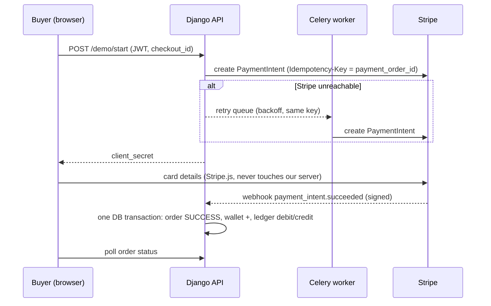

# Payment system demo (Django + Stripe)

A payment backend for an e-commerce store. At about 10 transactions per second the hard part is **correctness**, not throughput. It never charges twice, never loses a payment, and can always prove where the money went.

It is a demo, not a production system: refunds, pay-outs, rate limiting and high availability are deliberately left out.

| Doc | What it is |
|---|---|
| [`docs/ARCHITECTURE.md`](docs/ARCHITECTURE.md) | Components, data model, order lifecycle, failure handling |
| [`docs/DECISIONS.md`](docs/DECISIONS.md) | Design decisions, trade-offs, what was left out, how it was verified |
| [`docs/DEPLOY.md`](docs/DEPLOY.md) | Putting it on a server with HTTPS |

## What it does



- **Pay-in** for one store: a checkout becomes one payment order and one Stripe PaymentIntent.
- **Idempotent everywhere:** repeated requests, replayed webhooks and retries cannot create a second charge or a second ledger entry.
- **Double-entry ledger:** every payment writes a debit and a credit of the same amount. The ledger is append-only, enforced in Python and by a Postgres trigger.
- **Failure handling:** transient Stripe errors go to a Celery retry queue (exponential backoff and jitter); permanent ones, or exhausted retries, land in a dead letter table. `poll_pending` recovers lost webhooks.
- **Reconciliation:** `reconcile` compares our records with Stripe and the ledger with itself, and sorts mismatches into *auto-fixed*, *manual* and *unclassified*.
- **JWT login**, buyers isolated from each other, a staff-only operations panel, and a read-only admin.

Order status: `NOT_STARTED → EXECUTING → SUCCESS | FAILED` (a late failure never overwrites a success; a failed card can be retried to success).

## Run it locally

Prerequisites: Python 3.12+, Docker, the [Stripe CLI](https://github.com/stripe/stripe-cli/releases/latest) and a Stripe account (test mode).

```bash
make setup                      # venv + dependencies
cp .env.example .env            # add your Stripe TEST keys (or keep them in ../../.env, also read)
stripe login
make seed                       # demo buyer + staff accounts (prints a generated password once)
make dev                        # Postgres, Redis, migrations, web, Celery worker, Stripe listener
```

Docker resources are namespaced as `payment-demo` (containers `payment-demo-db-1` and `-redis-1`, volume `payment-demo_pgdata`; the production file uses `payment-demo-prod`), so they cannot collide with other Compose projects on your machine. Host ports: Postgres `5433`, Redis `6380`, web `8000`.

`make dev` prints the webhook signing secret (`whsec_...`) once; put it in `.env` as `STRIPE_WEBHOOK_SECRET` and restart. Then open <http://localhost:8000/> (the shop), add items, log in at checkout and pay with the test card `4242 4242 4242 4242` (any future date, any CVC; `4000 0000 0000 0002` is declined). The orders dashboard is at <http://localhost:8000/dashboard/>.

`make help` lists the other targets (`make test`, `make run`, `make worker`, `make listen`, `make reset-db`, ...).

### Or run everything in Docker

No venv or Stripe CLI needed; Stripe keys come from `.env` (copy `.env.example`).

```bash
cp .env.example .env            # Stripe TEST keys
make docker-up                  # Postgres, Redis, migrations, web (gunicorn), Celery worker, Stripe listener
docker compose logs stripe      # shows the whsec_... signing secret: put it in .env, then make docker-up again
make docker-seed                # demo buyer + staff accounts
make docker-test                # 69 tests inside the app image
make docker-down                # stop (data is kept in the pgdata volume)
```

The app containers belong to the Compose profile `app`, so `make infra` and the venv workflow above still start only Postgres and Redis. The image is not rebuilt automatically for code changes: run `make docker-up` again.

### Environment

| Variable | Default | Meaning |
|---|---|---|
| `STRIPE_SECRET_KEY`, `STRIPE_PUBLISHABLE_KEY`, `STRIPE_WEBHOOK_SECRET` | none | Stripe test keys |
| `DB_HOST`, `DB_PORT`, `DB_NAME`, `DB_USER`, `DB_PASSWORD` | `localhost`, `5433`, `payments` ×3 | PostgreSQL |
| `CELERY_BROKER_URL` | `redis://localhost:6380/0` | Redis |
| `PAYMENT_MAX_RETRIES`, `PAYMENT_RETRY_BASE_SECONDS` | `5`, `2` | Retry queue |
| `ALLOW_REGISTRATION` | `1` | Set to `0` to close self-service sign-up |
| `STRIPE_API_BASE` | empty | Point at a dead address (e.g. `http://127.0.0.1:9`) to simulate a Stripe outage |
| `DJANGO_DEBUG`, `DJANGO_SECRET_KEY`, `DJANGO_ALLOWED_HOSTS`, `DJANGO_CSRF_TRUSTED_ORIGINS`, `DJANGO_BEHIND_PROXY` | debug on | Production settings, see `docs/DEPLOY.md` |

## API

All `/v1/*` and `/demo/*` endpoints need `Authorization: Bearer <access token>`.

| Endpoint | Purpose |
|---|---|
| `POST /auth/register` | `{username, password}` (8+ chars); 403 when registration is closed |
| `POST /auth/token`, `POST /auth/token/refresh` | Log in (`{access, refresh}`), renew the access token (30 min) |
| `GET /v1/me` | Who the token belongs to |
| `POST /v1/payments` | `{checkout_id, payment_orders: [{payment_order_id, seller_account, amount_minor, currency}]}`. Idempotent on `checkout_id`. The buyer is the token's user |
| `GET /v1/payments/{payment_order_id}` | Status of one of your orders (404 for anyone else's) |
| `GET /v1/dashboard` | Your orders, ledger rows and wallets; staff also get mismatches and dead letters |
| `POST /demo/start` | Demo checkout: `{checkout_id, items: [{id, qty}]}`. The server prices the cart from its own catalog |
| `POST /webhooks/stripe/` | Stripe's webhook; authenticated by signature, not JWT |

```bash
TOKEN=$(curl -s -H 'Content-Type: application/json' localhost:8000/auth/token \
  -d '{"username":"demo","password":"..."}' | python3 -c 'import sys,json;print(json.load(sys.stdin)["access"])')
curl -H "Authorization: Bearer $TOKEN" localhost:8000/v1/me
```

## Operations

```bash
.venv/bin/python manage.py poll_pending --older-than-minutes 30   # recover lost webhooks, re-queue stuck orders
.venv/bin/python manage.py reconcile --days 1                     # compare with Stripe, record mismatches
```

Run them from cron or Celery beat in a real deployment. Staff see results on the dashboard and in `/admin/`.

## Tests

```bash
make test        # 69 tests, Stripe mocked, needs Postgres (make infra)
make lint
```

## Layout

```
config/            settings, Celery app, URLs
payments/
  models.py        events, orders, wallet, ledger, webhook events, mismatches, dead letters
  services.py      the payment logic: create, start, mark_success/failed, dead-lettering
  tasks.py         Celery retry task and backoff
  views.py         JWT-protected API, Stripe webhook, demo pages
  management/      poll_pending, reconcile, seed_demo
  templates/       shop, checkout, orders dashboard, login (Django templates + static CSS/JS, SVG art)
  tests/           flow, auth, retry queue, ledger, concurrency, commands, admin
deploy/, Dockerfile, docker-compose*.yml (dev: infra + optional `app` profile; prod), scripts/dev.sh, Makefile
```
