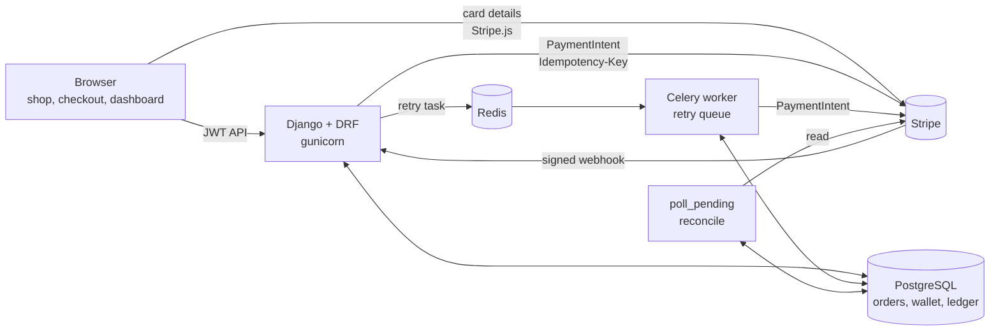
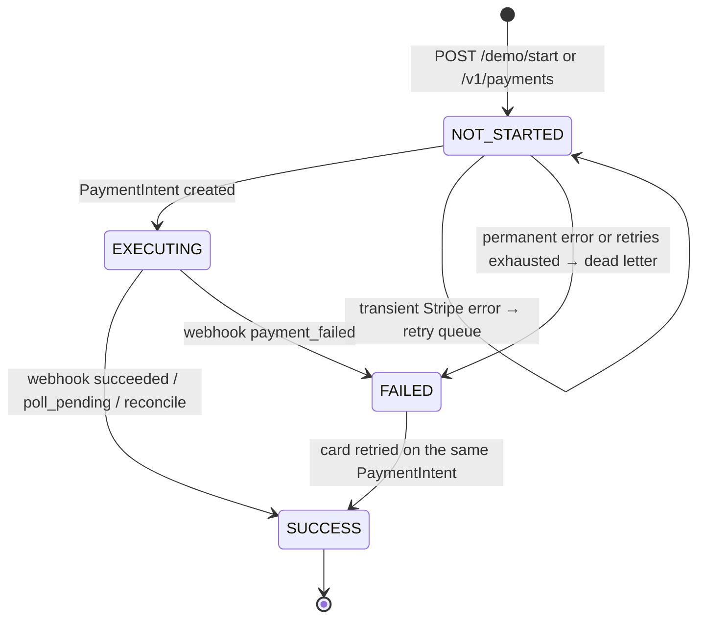

# Architecture

A pay-in payment backend for one store. The design goal is correctness at modest volume (~10 TPS): **never charge twice, never lose a payment, always be able to prove where the money went.** The reasoning behind each choice is in [`DECISIONS.md`](DECISIONS.md).

## Components



| Component | Role | Code |
|---|---|---|
| Django + DRF | JWT-protected API, Stripe webhook, server-rendered pages | `payments/views.py`, `payments/urls.py` |
| Payment service | Create orders, call Stripe, apply success/failure, dead-lettering | `payments/services.py` |
| PostgreSQL | Source of truth; transactions and row locks give correctness | `payments/models.py`, `payments/migrations/` |
| Celery + Redis | Retry queue for the Stripe call only, with backoff and a retry limit | `payments/tasks.py` |
| Recovery jobs | `poll_pending` (lost webhooks, stuck orders), `reconcile` (compare with Stripe) | `payments/management/commands/` |
| Catalog | Server-side products and prices; the browser sends only ids and quantities | `payments/catalog.py` |

## Data model

```
PaymentEvent (checkout_id PK, buyer)                  one checkout
  └── PaymentOrder (payment_order_id PK, seller,      one charge; also Stripe's Idempotency-Key
        amount_minor, status, stripe_payment_intent_id,
        wallet_updated, ledger_updated)
        ├── LedgerEntry × 2 (debit buyer, credit seller)   append-only (Python guard + Postgres trigger)
        └── DeadLetter (reason, error, attempts)           orders that need a human
Wallet (seller, balance_minor)
StripeEvent (event_id PK)                             webhook deduplication
Mismatch (bucket, payment_order_id, detail)           reconciliation output
```

Amounts are integer minor units (`1999` = $19.99).

## Order lifecycle



`SUCCESS` is final: a late failure event never overwrites it. The move to `SUCCESS` sets the status, credits the wallet and writes both ledger rows in **one transaction under a row lock**, so it is safe to apply twice and from several sources at once.

## Happy path

1. The browser sends `{checkout_id, items: [{id, qty}]}` with its JWT. The server prices the cart and stores the event and order (`NOT_STARTED`). A repeated `checkout_id` returns the same order.
2. The server creates a Stripe PaymentIntent with `Idempotency-Key = payment_order_id` and stores its id (`EXECUTING`). The browser receives the `client_secret`.
3. The browser sends card details straight to Stripe (Payment Element). Card data never reaches this server.
4. Stripe sends a signed `payment_intent.succeeded` webhook. The handler verifies the signature, records the event id (deduplication) and applies `mark_success` in the same transaction.
5. The browser polls `GET /v1/payments/{id}` until it sees `SUCCESS`.

## When things go wrong

| Failure | What happens | Where |
|---|---|---|
| Duplicate request / double click | Primary key on `checkout_id` returns the existing order; Stripe's idempotency key prevents a second PaymentIntent | `services.create_payment` |
| Same `checkout_id`, different cart | `409 Conflict` | `services.create_payment` |
| Stripe unreachable / 5xx / rate limited | Order stays `NOT_STARTED`; Celery retries with exponential backoff and jitter, same idempotency key | `services.start_or_defer`, `tasks.py` |
| Permanent Stripe error, or retries exhausted | Order `FAILED`, row in the dead letter table for an operator | `services.dead_letter` |
| Redis down | Request still succeeds; the next request or `poll_pending` re-queues the order | `services.enqueue_start` |
| Webhook replayed | `StripeEvent` primary key rejects the duplicate; nothing changes | `views.stripe_webhook` |
| Webhook lost | `poll_pending` asks Stripe about old `EXECUTING` orders and applies the result | `poll_pending` |
| Worker killed mid-task | Late acknowledgement: the task is redelivered | `config/settings.py` |
| Anything else that drifted | `reconcile` compares with Stripe and checks the ledger balances; mismatches are *auto-fixed*, *manual* or *unclassified* | `reconcile` |

## Security boundaries

- **Browser → API:** JWT bearer tokens; the buyer is always taken from the token. Other buyers' orders return 404.
- **Stripe → API:** the webhook is authenticated by Stripe's signature over the raw body, not by a JWT.
- **Card data:** collected by Stripe's form; this server never sees it.
- **Prices:** computed on the server from the catalog; client-sent prices are ignored.
- **Operations:** reconciliation and dead letters are visible to staff only; the admin is read-only for money tables.

## Deployment

- **Local:** `make dev` (venv, with Postgres and Redis in Docker) or `make docker-up` (everything in containers, including the Stripe CLI listener). See the [README](../README.md).
- **Server:** `docker-compose.prod.yml`: Caddy (automatic HTTPS) → gunicorn, a Celery worker, Postgres, Redis. See [`DEPLOY.md`](DEPLOY.md).
- **CI:** GitHub Actions runs tests on Postgres and Redis, pyflakes, a missing-migrations check, and a Docker build with Django's deploy checks.
